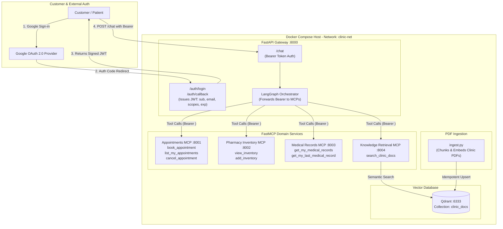

# Clinic Assistant v2: System Architecture

## Architecture Diagram

## Trust Model and Security Boundaries

All services run on a single host orchestrated via Docker Compose within the isolated `clinic-net` bridge network. 

1. **Authentication & Token Minting:** The FastAPI gateway (Port 8000) acts as the entry point and OAuth 2.0 client. When a customer authenticates with Google, the gateway exchanges the authorization code for verified user information (`sub` and `email`), and mints a cryptographically signed JSON Web Token (JWT) using the `HS256` algorithm and a shared `JWT_SECRET`. The token contains `sub`, `email`, `scopes`, and an expiration time (`exp`, 1 hour).
2. **Shared Secret Verification:** Because FastAPI and the FastMCP domain containers share the same `JWT_SECRET` via environment variables injected by Docker Compose, each FastMCP server independently verifies the signature, expiration, and required scopes of the incoming `Authorization: Bearer <jwt>` header on every tool call. 
3. **Data Isolation:** Domain tools that access patient data (Appointments and Medical Records) take **no user ID parameter**. The identity is derived strictly from the verified `sub` claim in the token. FastMCP servers trust the `sub` claim because only the gateway possesses the `JWT_SECRET` required to sign the token.
4. **Secret Isolation:** Tool secrets and vector database connections remain strictly within their respective container boundaries. The LangGraph agent holds zero domain secrets and acts purely as an orchestrator communicating with tools via MCP over HTTP.
