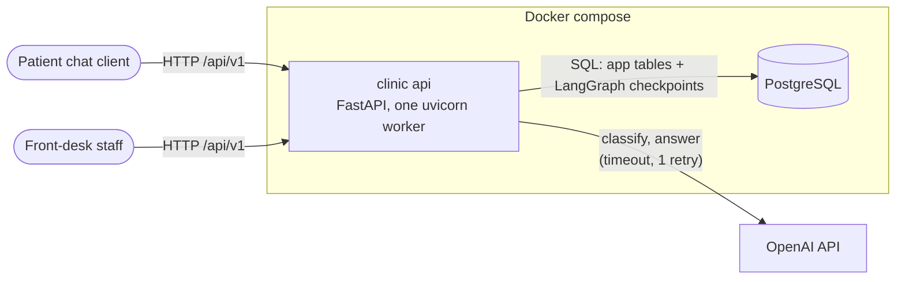
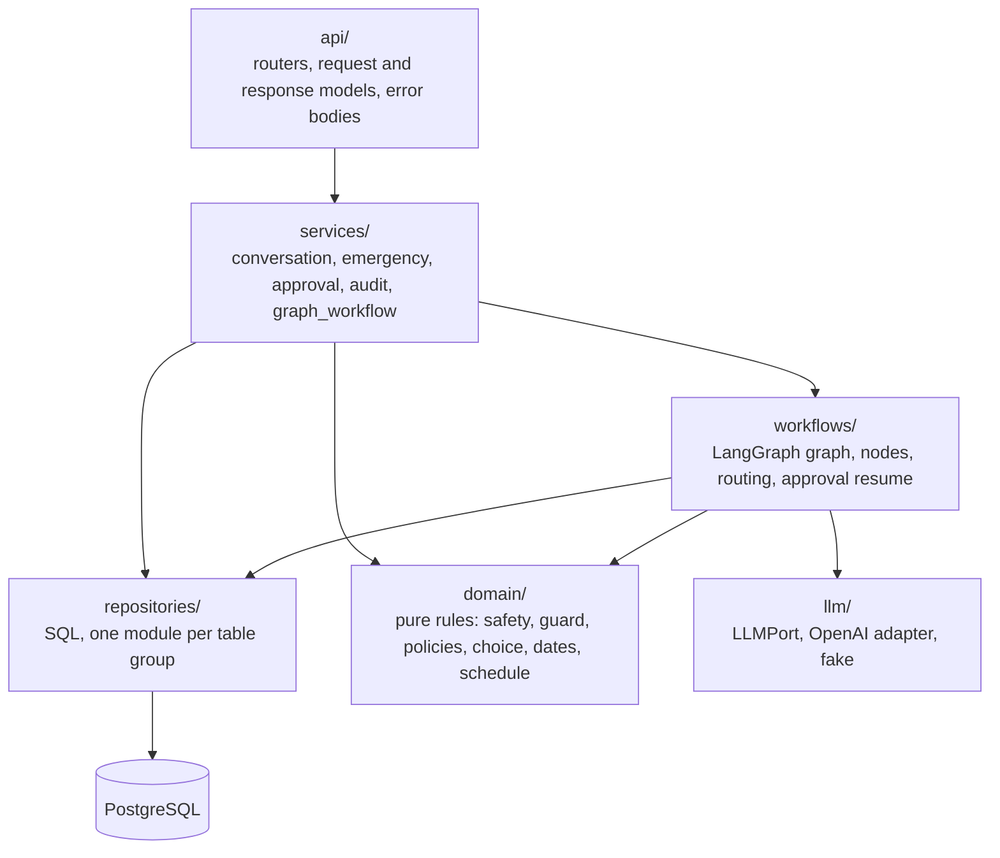
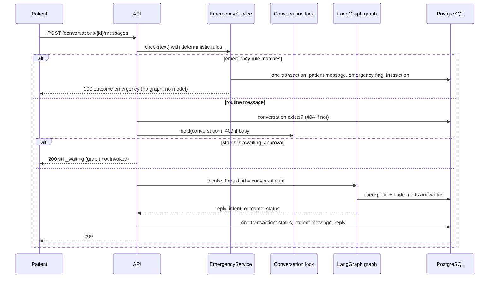
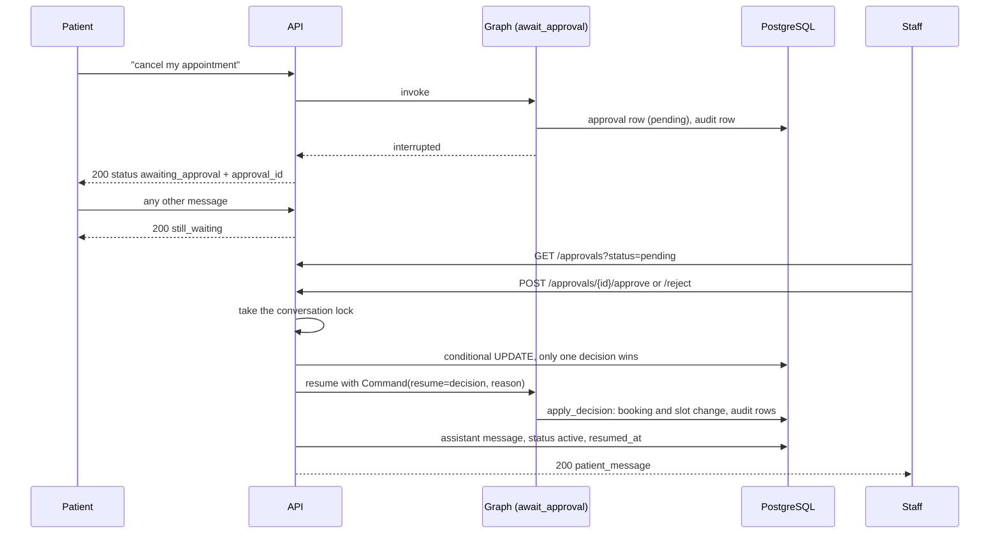
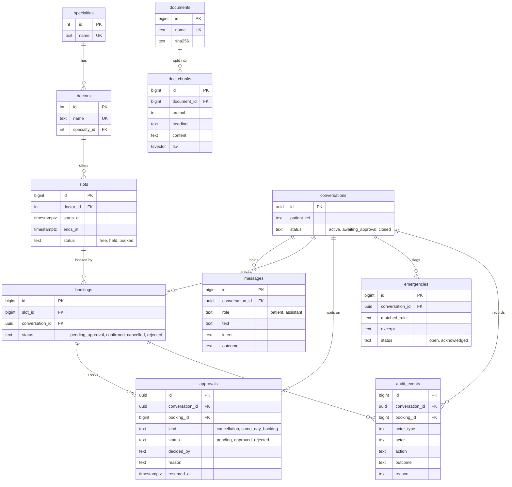

# Architecture (CFD-26)

One document for the whole system, checked against the code at `v0.1.1`. Detail lives in
[workflow.md](workflow.md) (the graph and every node), [api.md](api.md) (the HTTP contract) and
the decision records in [adr/](adr/).

Decision records: [0001 schema and seed under `db/`](adr/0001-schema-and-seed-under-db.md),
[checkpoints](adr/checkpoint-design.md), [human approval](adr/approval-design.md),
[retrieval](adr/rag-design.md).

## 1. System context

- There is no login. Patients and staff reach the same API; staff use the `emergencies`,
  `approvals` and `audit` endpoints.
- PostgreSQL is the only store: tables, full-text search and the conversation checkpoints.
- OpenAI is used for two things only: `classify` (intent and entities) and `answer` (a reply built
  from retrieved clinic documents). Everything else is plain code, so tests run with a fake model
  (`llm/fake.py`).

## 2. Layers

`api/` only parses requests and maps errors (`errors.py`). `services/` own a use case and its
transactions. `workflows/` hold the conversation graph; its nodes call `repositories/` and
`rag/retriever`. `domain/` has no I/O. `app.py` builds everything once at start and `deps.py`
carries the shared objects.

## 3. A patient message and the emergency short-circuit

`ConversationService.handle_message` decides the path. The emergency check is first of all, so it
needs neither the conversation lock, nor the workflow, nor the model.

If saving an emergency fails, the patient still gets the instruction (worded without "staff have
been alerted") and the failure is logged as `emergency.persist_failed`.

## 4. Approval pause and resume

A cancellation, and a booking for a slot that starts today, wait for staff. The graph pauses with
LangGraph `interrupt()`; the pause is a checkpoint, so it survives a restart.

- Decision saved but resume failed: `503 resume_failed`. Repeating the same decision finishes it;
  a different decision gets `409 already_decided`. At the next start `reconcile()` resumes any
  decided approval whose `resumed_at` is still empty.
- Emergencies are still answered while a conversation is paused.

## 5. Data model

Every table in `db/schema/`. Checkpoint tables are separate (see below).

Constraints that carry the rules (all in the SQL, not only in code):

- `bookings_one_active_per_slot`: a unique index on `slot_id` where the booking is
  `pending_approval` or `confirmed`.
- `approvals_one_pending_per_booking` and `approvals_one_pending_per_conversation`: partial unique
  indexes on `pending` rows.
- `audit_events` has a trigger that refuses every `UPDATE` and `DELETE`.
- `approvals` and `audit_events` reference conversations and bookings with `ON DELETE RESTRICT`.

LangGraph's `PostgresSaver.setup()` owns four more tables: `checkpoint_migrations`, `checkpoints`,
`checkpoint_blobs`, `checkpoint_writes`. The thread id is the conversation id; our SQL never
writes to them.

## 6. API

Base path `/api/v1` (except `/health`). Checked against the app's `/openapi.json`: it lists these
12 operations and no others. Every error body is `{"code", "detail", "request_id"}`. Any endpoint
that reads the database can also return `503 database_unavailable`; the table lists the other
statuses. `422` is `validation_error`. Full bodies are in [api.md](api.md).

| Method | Path | Request | Response | Statuses |
|---|---|---|---|---|
| GET | `/health` | none | `{status, database, version}` | 200; 503 `degraded` when the database is unreachable |
| GET | `/specialties` | none | list of `{id, name}` | 200 |
| GET | `/doctors` | `specialty` (optional) | list of `{id, name, specialty}` | 200, 404 unknown specialty, 422 |
| GET | `/slots` | `date` (required), `doctor_id` and/or `specialty` | list of free slots | 200, 404 unknown doctor or specialty, 422 |
| POST | `/conversations` | `{patient_ref}` | `{id, patient_ref, status, created_at}` | 201, 422 |
| POST | `/conversations/{id}/messages` | `{text}` | `{reply, intent, outcome, status, sources}` plus `approval_id` when a turn pauses | 200, 404, 409 `conversation_busy`, 422, 503 `llm_unavailable`, 503 `workflow_unavailable` |
| GET | `/conversations/{id}` | none | conversation and its messages, oldest first | 200, 404 |
| GET | `/emergencies` | `status` = `open` (default) or `acknowledged` | list of emergency flags | 200, 422 |
| GET | `/approvals` | `status`, `limit`, `offset` | list of approvals, oldest first | 200, 422 |
| POST | `/approvals/{id}/approve` | `{decided_by, reason}` | `{approval_id, status, patient_message}` | 200, 404, 409 `already_decided` or `conversation_busy`, 422, 503 `resume_failed` |
| POST | `/approvals/{id}/reject` | `{decided_by, reason}` | same as approve | same as approve |
| GET | `/audit` | `limit`, `offset`, `booking_id`, `conversation_id` | list of audit events, newest first | 200, 422 |

## 7. Risks

| Risk | What can go wrong | Mitigation in the code |
|---|---|---|
| Concurrent bookings | Two patients take the same slot | `book_slot` is one conditional `UPDATE` of a `free` slot plus the `INSERT`; the second request finds it no longer free and gets "slot taken". The partial unique index `bookings_one_active_per_slot` is a second guard |
| Two messages to one conversation | Interleaved turns number messages wrongly | In-process lock per conversation, non-blocking: the second request gets `409 conversation_busy`. This only holds with a single uvicorn worker, which is how the service runs (`locks.py`) |
| Checkpoint tables | Owned and migrated by LangGraph; a failed or missing setup breaks every turn | `setup_checkpointer` runs on every start on its own autocommit connection with the long setup timeout; if the database is down at start the api still starts, `/health` reports 503 and a background thread retries every 5 s. A turn before setup gets `503 database_unavailable` |
| Crash between a turn and its storage | Duplicate or missing turn in the checkpoint | Turn ids derive from the stored message count; a retry gets the same id and replaces the turn instead of duplicating it |
| Model latency or outage | A slow or failing model blocks the patient | Request timeout `LLM_TIMEOUT_S` (default 20 s) with `LLM_MAX_RETRIES` (default 1), then `503 llm_unavailable` with nothing stored. No database connection is held during the call. Emergencies, medical-advice declines and "not covered" replies need no model |
| Never-expiring approvals | A pending approval waits forever; the patient is not notified | **No mitigation.** There is no timeout, reminder or escalation, staff are not authenticated, and the patient sees the decision only on their next message or in the conversation. Recorded as a known limit in the [approval ADR](adr/approval-design.md) |
| Decision saved, resume failed | Conversation stuck in `awaiting_approval` | The decision is final; repeating it finishes the resume; `reconcile()` resumes unfinished ones at the next start |
| Medical advice from the model | A diagnosis or dosage reaches a patient | Prompt rule, input check before any model call, and an output guard in `finalize` (regular expressions, English only: a safety net, not a guarantee; see [workflow.md](workflow.md)) |
