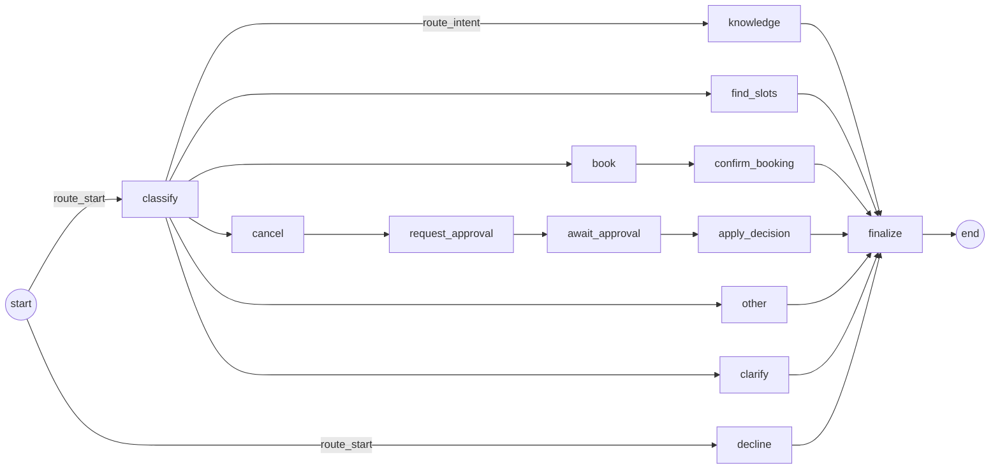

# Conversation workflow (CFD-05)

One LangGraph graph runs every patient message. Its state is checkpointed in PostgreSQL by
`PostgresSaver` under `thread_id = conversation id`, so a conversation continues with full context
after a restart. Code: `src/clinic/workflows/`.

Emergencies never reach the graph: `is_emergency()` runs first, in the service (CFD-08).

## Graph

| Node | File | Filled in by |
|---|---|---|
| `classify` | `nodes/classify.py` | CFD-07 |
| `clarify`, `other` | `nodes/reply.py` | CFD-07 |
| `knowledge` | `nodes/knowledge.py` | CFD-11 |
| `find_slots` | `nodes/appointments.py` | CFD-12 |
| `book`, `confirm_booking` | `nodes/appointments.py` | CFD-13 (same-day branch: CFD-15) |
| `cancel`, `request_approval`, `await_approval`, `apply_decision` | `nodes/approvals.py` | CFD-14 |
| `decline`, `finalize` | `nodes/safety.py` | CFD-09 |

Every node is `def node(state: ConversationState) -> dict[str, object]` and returns only the
fields it changes. Until its story lands, a node is a stub that replies with an honest
"can't help with that here yet, please call the front desk" (`outcome: "not_implemented"`).

## Routing (`routing.py`)

- `route_start`: `decline` if the deterministic medical-advice check matches the latest patient
  message, else `classify`. The check is passed in; until CFD-09 it never matches.
- `route_intent`: `clinic_question` → `knowledge`, `find_slots`, `book`, `cancel`, `other`.
  `unclear`, an unknown intent, or confidence below `INTENT_MIN_CONFIDENCE` → `clarify`.

## State (`state.py`)

Primitives only (plus LangChain messages), so checkpoints load under
`LANGGRAPH_STRICT_MSGPACK=true` and survive code changes.

| Field | Meaning |
|---|---|
| `messages` | Full history; nodes append, never replace |
| `intent`, `confidence`, `entities` | Set by `classify` for the current turn |
| `reply`, `outcome`, `sources` | This turn's answer; `finalize` appends `reply` to `messages` |
| `offered_slots` | Slots last shown; kept across turns for "book the first one" |
| `approval_id` | Pending staff approval |
| `status` | `active`, `awaiting_approval` or `closed` |

Start every turn with `graph.invoke(new_turn(text), {"configurable": {"thread_id": conversation_id}})`:
`new_turn` resets the per-turn fields so nothing leaks from the previous turn.

## History window (`history.py`)

The checkpoint keeps every message. Prompts get `history_window(messages, HISTORY_WINDOW)`: the
last `HISTORY_WINDOW` messages at most, starting with a patient message.

## Startup

On every start the lifespan runs `sql/*.sql` and `PostgresSaver.setup()` (both idempotent; setup
uses its own autocommit connection). The graph's saver uses a separate pool with autocommit and
dict rows, so the app pool keeps one-block-one-transaction semantics. If the database is down at
start, this is logged as `startup.database_unavailable`, `/health` reports 503, and a background
thread retries every 5 s until it succeeds (`startup.database_prepared_after_retry`). Any other
error is logged as `startup.database_prepare_failed` and retrying stops.

`finalize` raises `MissingReplyError` if a turn reaches it without a `reply`: a node that forgets
to answer fails loudly instead of being hidden behind a generic message.
