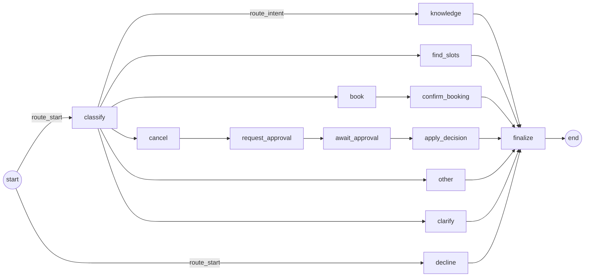

# Conversation workflow (CFD-05)

One LangGraph graph runs every patient message. Its state is checkpointed in PostgreSQL by
`PostgresSaver` under `thread_id = conversation id`, so a conversation continues with full context
after a restart. Code: `src/clinic/workflows/`.

Emergencies never reach the graph: `is_emergency()` runs first, in the service (CFD-08).

## Graph



| Node | File | Filled in by |
|---|---|---|
| `classify` | `nodes/classify.py` | CFD-07 (done) |
| `clarify`, `other` | `nodes/reply.py` | CFD-07 (done) |
| `knowledge` | `nodes/knowledge.py` | CFD-11 |
| `find_slots` | `nodes/appointments.py` | CFD-12 |
| `book`, `confirm_booking` | `nodes/appointments.py` | CFD-13 (same-day branch: CFD-15) |
| `cancel`, `request_approval`, `await_approval`, `apply_decision` | `nodes/approvals.py` (logic in `workflows/approval.py`, bookings in `workflows/bookings.py`) | CFD-14 (done) |
| `decline`, `finalize` | `nodes/safety.py` | CFD-09 |

Every node is `def node(state: ConversationState) -> dict[str, object]` and returns only the
fields it changes. A node that needs the database is built once by a factory
(`make_find_slots(deps)`) with a `WorkflowDeps` (settings, pool, clock), so its signature stays the
same. `build_graph(settings, checkpointer, deps)` uses those real nodes; without `deps` every node
is its stub (routing-only tests). Until its story lands, a node is a stub that replies with an honest
"can't help with that here yet, please call the front desk" (`outcome: "not_implemented"`).

## Routing (`routing.py`)

- `route_start`: `decline` if the deterministic medical-advice check matches the latest patient
  message, else `classify`. The check is `domain.guard.asks_for_medical_advice`.
- `route_intent`: `clinic_question` → `knowledge`, `find_slots`, `book`, `cancel`, `other`.
  `unclear`, an unknown intent, or confidence below `INTENT_MIN_CONFIDENCE` → `clarify`.
  `find_slots` and `book` that name a doctor or specialty missing from the catalogue also →
  `clarify`.

## Safety (`domain/guard.py`, `nodes/safety.py`)

No diagnosis and no treatment advice, in three layers:

1. **Prompt rule.** Every OpenAI system prompt tells the model not to diagnose or recommend treatment.
2. **Input check.** `route_start` sends a request for a diagnosis, a medicine or a dosage to
   `decline` before any LLM call. `decline` replies with fixed text and an offer to find an
   appointment (`outcome: "declined_medical_advice"`). No classify, no clinic documents.
3. **Output guard.** `finalize` checks every reply. A diagnosis, a treatment recommendation or a
   dosage is replaced by the decline text, the outcome becomes `declined_medical_advice`, and
   `safety.guard_triggered` is logged with the rule name only (never the reply or the patient's words).

Both checks are plain regular expressions on lower-cased text, so they are deterministic. They are
English only and a safety net next to the prompt, not a guarantee. They lean towards blocking:
a false alarm costs one polite redirect. Emergencies are handled before the graph (CFD-08).

## State (`state.py`)

Primitives only (plus LangChain messages), so checkpoints load under
`LANGGRAPH_STRICT_MSGPACK=true` and survive code changes.

| Field | Meaning |
|---|---|
| `messages` | Full history; nodes append, never replace |
| `intent`, `confidence`, `entities` | Set by `classify` for the current turn |
| `reply`, `outcome`, `sources` | This turn's answer; `finalize` appends `reply` to `messages` |
| `offered_slots` | Slots last shown; kept across turns for "book the first one" |
| `conversation_id`, `patient_ref` | Who the turn is for; set by `new_turn`, read by the approval nodes |
| `approval_id` (a UUID string), `approval_kind`, `booking_id`, `booking_label`, `decision`, `decision_reason`, `decided_approval_id` | The staff approval flow (CFD-14); see `ApprovalState` |
| `status` | `active`, `awaiting_approval` or `closed` |

Start every turn with:

```python
turn_id = turn_id_for(conversation_id, turn_number)  # turn_number = graph turns stored + 1
graph.invoke(
    new_turn(text, turn_id, conversation_id=conversation_id, patient_ref=patient_ref),
    {"configurable": {"thread_id": conversation_id}},
)
```

**Replay safety.** The patient message gets id `<turn_id>:patient` and the reply
`<turn_id>:reply`, and `add_messages` replaces a message with the same id. If the graph ran but
storing the turn in `messages` failed, the retry gets the same turn number and id, so it replaces
that turn in the checkpoint instead of duplicating it.

**Who numbers the turns (CFD-06).** `GraphWorkflow` (`services/graph_workflow.py`) counts the
patient messages stored in `messages` whose reply came from the graph
(`messages.count_graph_turns`). Replies from outside the graph do not count: an emergency
(CFD-08, `outcome: "emergency"`) and the "still waiting" answer to a paused conversation
(CFD-14, `outcome: "still_waiting"`). Counting them would renumber a turn whose retry is
pending, and the retry would no longer replace it.

`new_turn` resets the per-turn fields so nothing leaks from the previous turn, including the
approval fields (`approval_id`, `booking_id`, ...). It deliberately keeps `offered_slots` (for
"book the first one") and `status`. A paused conversation is never given a new turn (the service
answers "still waiting" instead), so a reset cannot lose a pending approval; the approval flow
sets `status` when it pauses and when a decision is applied.

## `classify`, `clarify`, `other` (CFD-07)

`classify` (built by `make_classify(deps)`) calls `LLMPort.classify(text, context)`. The context
holds today's date at the clinic, the earlier messages (at most `HISTORY_WINDOW` including the
latest, starting with a patient message) and the catalogue (doctor and specialty names, read from
the database each turn). It sets `intent`, `confidence` and `entities`:

| Entity | Meaning |
|---|---|
| `doctor`, `specialty` | The exact catalogue name. The model's answer is matched in code (`domain/catalogue.py`: case, "Dr." and a unique surname or first name are accepted), so later nodes never see a guessed name |
| `date` | `YYYY-MM-DD`, only if the model's value is a valid date |
| `unknown_doctor`, `unknown_specialty` | What the model returned when it is not in the catalogue (cut to 80 characters). The router sends `find_slots` and `book` to `clarify` |
| `valid_choices` | Set with an unknown name: the valid doctors and specialties for `clarify` to list |

A model outage raises `LLMUnavailable` (API 503) before the turn writes anything.

`clarify` asks one fixed question (`outcome: "clarify"`). With an unknown doctor or specialty it
lists the valid names instead, and never repeats what the patient typed. `other` replies with a
fixed capabilities message (`outcome: "other"`). Neither reply is written by the model, and neither
writes to the database. `seed/sample_messages.json` holds sample patient messages with the intent
and node each must reach; a test runs them through the graph.

## `find_slots` (CFD-12)

Reads `doctor` or `specialty` and `date` (`YYYY-MM-DD`) from `entities`. A missing, invalid or past
date means today, from now on. It replies with up to 5 numbered free slots in clinic time
(`outcome: "slots_listed"`) and stores them as `offered_slots`:
`[{"slot_id", "doctor_id", "doctor", "starts_at"}]`, so "book the first one" (CFD-13) can use them.
If that day has none, it says so and offers the next day that has free slots
(`outcome: "no_slots"`). An unknown or missing doctor gets a question listing the doctors
(`outcome: "clarify"`) and leaves earlier `offered_slots` untouched.

## `knowledge` (CFD-11)

Answers a clinic question only from the clinic's documents (CFD-10 chunks), naming the source.

1. `rag.retriever.search` runs a PostgreSQL full-text search (no vector store). The question's
   words, stemmed and without stop words, are combined with OR. A chunk's searchable words are its
   heading, its text and its document's file name (`cancellation-policy.md` reads as
   "cancellation policy"). Chunks are ranked by `ts_rank_cd` with normalization 32
   (`rank / (rank + 1)`, so scores are in [0, 1)). At most `RAG_TOP_K` chunks are kept, best
   first, each scoring at least `RAG_MIN_SCORE` **and** sharing at least 2 words with the
   question: one shared word ("test" in "Can you test my eyes?") is not an answer. A question of
   stop words only finds nothing.
2. No chunk: the fixed "not covered, please call the front desk" reply
   (`outcome: "not_in_documents"`, `sources: []`). **The model is not called.**
3. Otherwise `LLMPort.answer` gets only those chunks (heading + text, document name as source).
   Its answer is used only if it has text and cites one of the documents it was given; anything
   else, including a cited document that was not retrieved, is `not_in_documents` (the latter is
   logged as `knowledge.ungrounded_source`).
4. Answered: the reply ends with `Source: <document>`, `outcome: "answered"`, and `sources` lists
   `{"document", "heading"}` of the retrieved chunks of the cited document. The api returns them.

The database connection is released before the model call.

## History window (`history.py`)

The checkpoint keeps every message. Prompts get `history_window(messages, HISTORY_WINDOW)`: the
last `HISTORY_WINDOW` messages at most, starting with a patient message.

## Startup

On every start the lifespan runs `sql/*.sql` and `PostgresSaver.setup()` (both idempotent; setup
uses its own autocommit connection). The graph's saver uses a separate pool with autocommit and
dict rows, so the app pool keeps one-block-one-transaction semantics. If the database is down at
start, this is logged as `startup.database_unavailable`, `/health` reports 503, and a background
thread retries every 5 s until it succeeds (`startup.database_prepared_after_retry`). Only
"cannot reach the database" is retried (no SQLSTATE, class 08, or 57P01-57P03). Any other error,
such as a timed-out migration, stops a first start or is logged as
`startup.database_prepare_failed` and stops the retry. Setup connections use a 5-minute
statement timeout (`SETUP_STATEMENT_TIMEOUT_MS`) instead of the 5 s request timeout, so a
migration on a large checkpoint table is not cancelled.

`finalize` raises `MissingReplyError` if a turn reaches it without a `reply`: a node that forgets
to answer fails loudly instead of being hidden behind a generic message.
